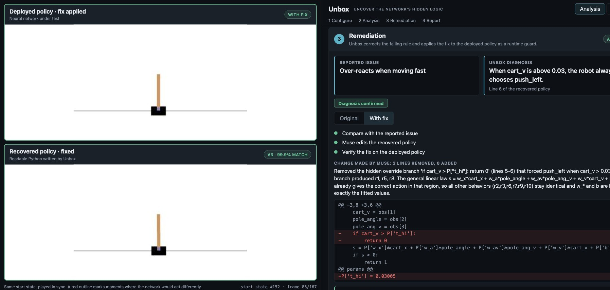
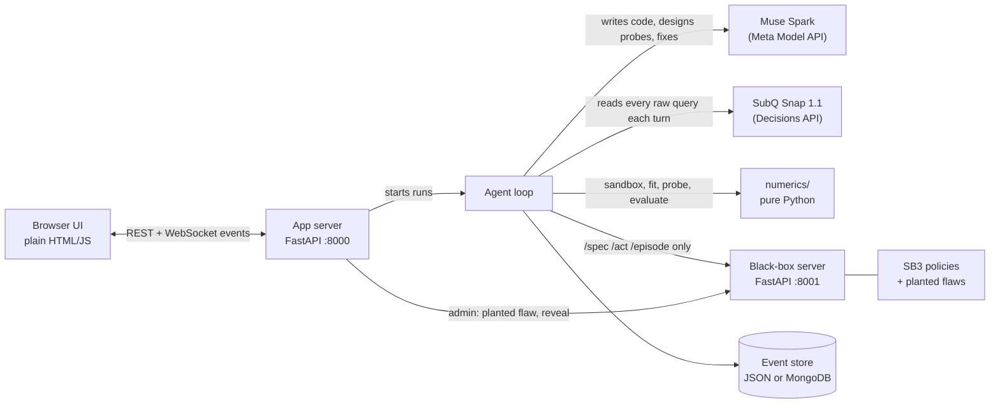

# Unbox

**Uncover the network's hidden logic.** Unbox turns a robot's neural-network controller into short, readable Python that makes the same decisions, finds the exact rule behind a failure, and fixes it without touching the network's weights.

> Team: [@shanayg15](https://github.com/shanayg15) · [@tarunrajesh07](https://github.com/tarunrajesh07) · Built at the AIE Code Summit hackathon, Nov 7 2026 (Software Archaeology track)

   



---

## The problem

Robots are increasingly driven by neural networks. When one misbehaves ("it drifts in one corner of the track", "it freezes near the wall"), nobody can point to the line that causes it: the behaviour is spread across thousands of weights. Teams retrain on more data and hope, with no way to say *which* decision was wrong, *where* it happens, or whether the retrained network still does everything else the same.

## What Unbox does

1. **Watch.** Unbox only talks to the network through an API: it shows it situations and sees which action it picks. No weights, no training data.
2. **Imitate.** It writes a short Python program (typically 7 to 15 lines) that makes the same decisions, keeps a ledger of the rules it believes, and proves or rejects each rule with targeted experiments. The copy runs side by side with the real robot from the same start, so you can see it succeed and fail at the same moments.
3. **Diagnose.** When a failure exists, it is already a readable line of the copy, for example: *"When cart_x is below -0.08, the robot always chooses push_right."*
4. **Fix.** One click: the language model removes that line, the corrected rule is applied to the real network as a runtime guard only inside the failure region, and Unbox verifies nothing else changed.
5. **Report.** A diagnostic report for the robotics team: the failing decision and its code line, where and how often it fires, what it costs, a targeted training set for retraining, and regression tests that must still pass afterwards.

## Impact, measured

On the CartPole and MountainCar policies used in the demo (16 batch runs, each with and without the SubQ evidence scan; all numbers from [`results/`](results/)):

| Measure | Result |
|---|---|
| Planted failures found | **5 of 5** with SubQ Snap (4 of 5 without) |
| Behavioural fidelity (median agreement on unseen states) | **93.2%** (vs 87.0% for a controller the LLM writes without querying the network) |
| Queries needed to find the failure | **574 vs 1,164** without SubQ (−51%; up to 8.7× fewer on one flaw) |
| Specificity (copy vs its own network / a sibling network) | **94.5% vs 59.4%** agreement |
| Speed of the readable copy vs the network | **12× faster** (median) |

After **Apply fix**, measured live on 5 test starts:

| Failure | Change made | Reward | Task success |
|---|---|---|---|
| CartPole: "over-reacts when moving fast" | removed `if cart_v > P['t_hi']: return 0` | 345 → **500** | 3/5 → **5/5** |
| CartPole: "drifts in one zone of the track" | removed `if x < P['x_thr']: return 1` | 178 → **500** | 1/5 → **5/5** |
| MountainCar: "freezes in one corner" | removed `if x <= P['p0']: return 1` | −146 → **−99** | 1/5 → **5/5** |

Outside the failure region the guarded network chooses the same action as the original on 99.9 to 100% of held-out states.

---

## Architecture



**Division of labour:** SubQ Snap reads all the evidence and says where to look; Muse writes and revises the code; Python decides what is true. The language model never sets a number (an optimizer fits every threshold) and never marks a rule confirmed (only probe experiments do).

### The analysis loop

| Step | What happens | Technology |
|---|---|---|
| 1. Observe | 8 episodes of the robot's own behaviour + 8 held-out episodes for scoring | Gymnasium, black-box `/episode` |
| 2. Scan | Every raw decision is sent to SubQ Snap, which returns calibrated probabilities for which sensor explains the disagreements and what to probe next | SubQ Snap Decisions API (up to 384K tokens per scan) |
| 3. Write | Muse writes `def policy(obs, P)` plus ledger rules and up to 3 experiments | Muse Spark via the OpenAI-compatible Meta Model API |
| 4. Fit | Every threshold in `P` is fitted to the data | CMA-ES (discrete) / least squares (continuous) |
| 5. Prove | Sweeps confirm (≥ 85% agree) or reject (≤ 40%) each rule | `agent/probes.py` |
| 6. Hunt | A prober searches for states where the copy and the network disagree | `numerics/prober.py` |
| 7. Check | The copy's own episode must end like the robot's from the same start (one-to-one check) | `agent/loop.py` |
| 8. Fix | Muse removes the diagnosed rule; the guard applies the correction inside the failure region | `agent/fixer.py`, `app/report.py` |

Every program runs in an AST-whitelisted sandbox: one function, no loops, no imports, no attributes starting with `_`.

---

## Quick start

Requires Python 3.11 and API keys for the Meta Model API and SubQ.

```bash
git clone https://github.com/shanayg15/Unbox.git && cd Unbox
python3.11 -m venv .venv && source .venv/bin/activate
pip install swig && pip install -r requirements.txt
cp .env.example .env        # add MODEL_API_KEY and SUBQ_API_KEY; set USE_MOCKS=0
```

Run the two servers in separate terminals:

```bash
uvicorn blackbox.server:app --host localhost --port 8001
```

```bash
uvicorn app.server:app --host localhost --port 8000
```

Open http://localhost:8000. Pick a robot policy and a scenario, press **Run analysis**, then **Apply fix**. A walkthrough of every control is in [docs/UI_GUIDE.md](docs/UI_GUIDE.md).

Other commands:

```bash
python -m scripts.smoke                                   # check keys, black box, numerics
python -m scripts.batch --snap 1,0                        # reproduce results/ (with and without SubQ)
pytest -q                                                 # 340 tests
```

## API

| Endpoint | Purpose |
|---|---|
| `POST /api/run` `{bb, twist_id}` | Start a live analysis; returns `run_id` |
| `WS /ws/{run_id}` | Event stream (`frames`, `program`, `ledger`, `snap`, `metric`, `run_finished`, …; schema in `contracts/events.py`) |
| `POST /api/reveal`, `/api/fix`, `/api/shield` | Compare with the reported issue, fix the copy, apply the guard |
| `GET /api/report/{run_id}` | Diagnostic report as JSON |
| `GET /api/report/{run_id}.md`, `/training.csv`, `/tests.json` | Report, targeted training set, regression tests |
| `GET /api/results` | Batch results behind the Results tab |
| Black box: `GET /spec`, `POST /act`, `POST /episode`, `GET /count` | The only calls the agent can make |

```bash
curl -s -X POST localhost:8000/api/run -H 'content-type: application/json' \
  -d '{"bb": "bb-01", "twist_id": "t-cp-2"}'
# {"run_id": "live-153006-296160"}
```

## Project structure

| Path | Contents |
|---|---|
| `blackbox/` | Policy server: SB3 checkpoints behind `/act` and `/episode`, planted flaws, admin endpoints |
| `agent/` | Brain client, SubQ Snap scan, prompts, probes, ledger, analysis loop, fixer |
| `numerics/` | Sandbox, parameter fitting, pattern hints, counterexample prober, evaluator, guard |
| `app/` | FastAPI server, WebSocket bridge, replay and fallback, diagnostic report, UI (`static/`) |
| `contracts/` | Shared types, numerics API, event schema, mocks |
| `store/` | JSON and MongoDB event stores |
| `scripts/` | Smoke test, batch runner, UI fixture generator |
| `results/`, `cache/` | Batch results and stored runs used for replay |
| `tests/` | 340 tests, including an isolation test that keeps the agent away from weights and admin endpoints |

## Reliability and limits

- **Isolation is enforced.** `tests/test_isolation.py` fails the build if the agent imports a model library or calls an admin endpoint.
- **Live runs are capped at 75 s.** Muse takes 15 to 25 s per turn, so some live runs cannot converge in time; the app then shows a stored run of the same configuration and says so in a banner.
- **One-to-one copies.** On both CartPole failures the copy fails at exactly the robot's step. On MountainCar (start state #13) the flawed robot needs 130 steps to reach the goal and its copy 129; with the fix applied the robot needs 88. On some other MountainCar start states the copy (92% single-decision match) still diverges, and the one-to-one check flags it.
- Every brain call is logged to `runs/<run_id>/brain_calls.jsonl` (provider, model, latency, tokens, status).

## Built during the hackathon

Everything in this repository was written on Nov 7, 2026: `blackbox/`, `numerics/`, `agent/`, `store/`, `app/`, `contracts/`, `scripts/`, `fixtures/`, `tests/`, `docs/`.

| Sponsor technology | How Unbox uses it | Evidence |
|---|---|---|
| **Meta Model API (Muse Spark)** | Writes and revises the readable policy, designs experiments, writes the ledger and the fix | Live runs, `brain_calls.jsonl` |
| **SubQ Snap 1.1** (Decisions API) | Reads the entire raw query log every turn and says which sensor explains the failure and what to probe next | Evidence-scan panel; with-vs-without ablation in `results/` |
| **MongoDB Atlas** (optional) | `STORE=mongo` stores events, queries, ledger and programs | Collections filled by a run |

## Third-party

- Policies under study: [Stable-Baselines3 RL Zoo](https://github.com/DLR-RM/rl-baselines3-zoo) checkpoints on Hugging Face: [sb3/ppo-CartPole-v1](https://huggingface.co/sb3/ppo-CartPole-v1), [sb3/dqn-CartPole-v1](https://huggingface.co/sb3/dqn-CartPole-v1), [sb3/dqn-MountainCar-v0](https://huggingface.co/sb3/dqn-MountainCar-v0), [sb3/ppo-LunarLander-v2](https://huggingface.co/sb3/ppo-LunarLander-v2), [sb3/dqn-LunarLander-v2](https://huggingface.co/sb3/dqn-LunarLander-v2), [sb3/ppo-Acrobot-v1](https://huggingface.co/sb3/ppo-Acrobot-v1)
- Environments: [Gymnasium](https://gymnasium.farama.org/)

## License

MIT. See [LICENSE](LICENSE).
